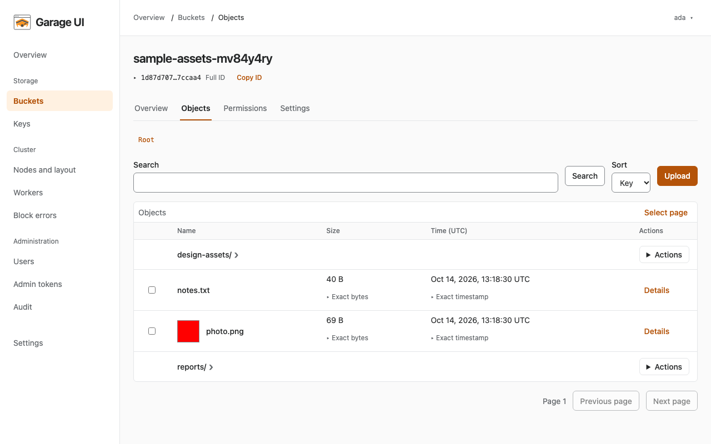
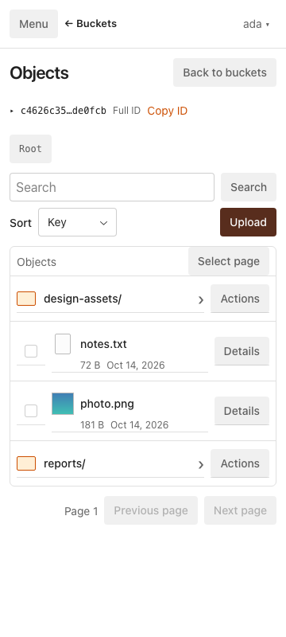

<p align="center">
  
</p>

# Garage UI

[](https://github.com/xjoker/garage-ui/releases)

**Your Garage cluster, buckets, and files in one browser.**

Garage UI is an unofficial web interface for [Garage](https://garagehq.deuxfleurs.fr/), the S3-compatible object store from Deuxfleurs. Browse your storage, upload and download files, manage access, and check your cluster without switching between tools. One Rust binary serves the React interface and connects to your Garage Admin and S3 APIs. The interface uses Radix Themes for accessible controls and adapts to narrow screens.



<details>
<summary>On a smaller screen</summary>



</details>

## What you can do

- **Work with files:** browse folders, preview media and text, upload files or folders, download selections as ZIPs, and create expiring share links.
- **Organize storage:** create buckets, manage aliases and quotas, configure CORS and lifecycle rules, and clean up incomplete uploads.
- **Control access:** manage Garage keys and admin tokens, give UI users administrator or viewer access, and grant viewers download and share permissions separately.
- **See what needs attention:** check cluster health and capacity, manage nodes and layout, inspect workers and block errors, and run repair tasks.
- **Keep daily work comfortable:** use light or dark mode, English or Simplified Chinese, and layouts that adapt to desktop and narrow screens.

Compatibility has been tested with **Garage v2.3.0 and v2.4.1**. Versions older than v2.3.0 cannot perform writes through the UI. Build from source for development. Check [Releases](https://github.com/xjoker/garage-ui/releases) for published artifacts; an unpublished draft does not provide public downloads.

## Build and run

Both Compose paths below build the UI from source. The first build downloads pinned toolchains and dependencies, so allow time for it to finish. Start with the current development branch:

```sh
git clone --branch dev https://github.com/xjoker/garage-ui.git
cd garage-ui
```

### Connect to your existing Garage

You need Docker with buildx, a running Garage v2.3.0 or v2.4.1 cluster, its Admin API token, and its S3 endpoint and region. All endpoint addresses must be reachable from the UI container; `127.0.0.1` inside that container refers to the container itself.

Create a private local configuration file:

```sh
cp .env.example .env
chmod 600 .env
```

Edit `.env` and fill all four settings with your cluster's actual values before starting the UI. Keep it out of version control.

| Setting | Value to supply |
|---|---|
| `GARAGE_ADMIN_URL` | Garage Admin API URL, usually on port 3903 |
| `GARAGE_ADMIN_TOKEN` | Garage Admin API token |
| `S3_ENDPOINT_URL` | Garage S3 API URL, usually on port 3900 |
| `S3_REGION` | Region configured in Garage |

From the repository root, start the [existing-cluster Compose service](deploy/compose.external.yaml):

```sh
COOKIE_SECURE=false docker compose --env-file .env \
  -f deploy/compose.external.yaml up -d --build
```

Open [http://127.0.0.1:3909](http://127.0.0.1:3909) and create your first administrator. `COOKIE_SECURE=false` is for this local HTTP address; use HTTPS and the default secure cookies when serving the UI remotely.

For file-backed secrets, private certificates, reverse proxies, and browser-reachable share URLs, see the [operator guide](docs/wiki/Home.md).

### Try a local Garage

The [Compose example](deploy/compose.yaml) runs the UI alongside a separate single-node Garage v2.4.1 instance. It is for local evaluation; it stores data in Docker volumes.

```sh
docker compose -f deploy/compose.yaml up -d --build
```

Open [http://127.0.0.1:3909](http://127.0.0.1:3909) and create your first administrator. Garage initializes its single-node layout automatically, so you can create a bucket and upload files after setup. See the [operator guide](docs/wiki/Home.md) for troubleshooting.

### Run the binary directly

Install the pinned Rust toolchain and Bun version, then build from the repository root:

```sh
scripts/build.sh
```

Set the Garage connection variables in `.env`, plus `COOKIE_SECURE=false` for local HTTP, and run:

```sh
./target/release/garage-ui
```

The binary listens on `127.0.0.1:3909` by default. Toolchain details and development checks are in [Contributing](CONTRIBUTING.md).

The production build embeds `web/dist` in that binary. The runtime uses one image, process, and port; Bun is only needed while building. There is no separate frontend service, browser CDN, or Node.js runtime to configure.

To build and load local Linux images separately, run `scripts/build.sh --images amd64` or `scripts/build.sh --images arm64`. With no architecture argument, it builds both. Default tags are `garage-ui:<VERSION>-local-amd64` and `garage-ui:<VERSION>-local-arm64`; an explicit `BUILD_VERSION` produces `garage-ui:<BUILD_VERSION>-<architecture>`. See the [stable, development, and local version policy](docs/engineering.md#79-release-and-images). The script does not publish images.

## Keep your data and credentials safe

The first visit creates an administrator; authentication stays enabled. The Garage admin token stays on the server, and browser sessions use an HttpOnly cookie. Keep the UI private or behind an HTTPS reverse proxy, and use a Garage token with only the scopes you need.

Persist and back up `/data` in containers, or `DATA_DIR` when running the binary (default: `./data`). It contains UI accounts, sessions, audit records, bucket-to-key mappings, and the generated session key. Stop the UI before copying this directory for a consistent backup. Garage stores the actual objects and cluster state: back up its data and configuration separately. Removing Docker volumes deletes their persisted data.

## Documentation and contributing

- [Operator guide and reference](docs/wiki/Home.md): deployment, configuration, storage, permissions, cluster operations, and troubleshooting.
- [Contributing](CONTRIBUTING.md): local development, focused verification, and AI-assisted contributions.
- [Requirements](docs/README.md): the working specification and acceptance targets. Requirements are not a record of completed verification.
- [Delivery status and roadmap](docs/roadmap.md): implemented areas, verification limits, and deferred work.
- [Verification evidence](docs/README.md#verification-evidence): dated reports, source identities, limits, and reproduction commands.

Garage UI is under active development. The CI workflow remains disabled during development; verification reports apply to their recorded source revisions and artifacts.

## License

[MIT](LICENSE).
